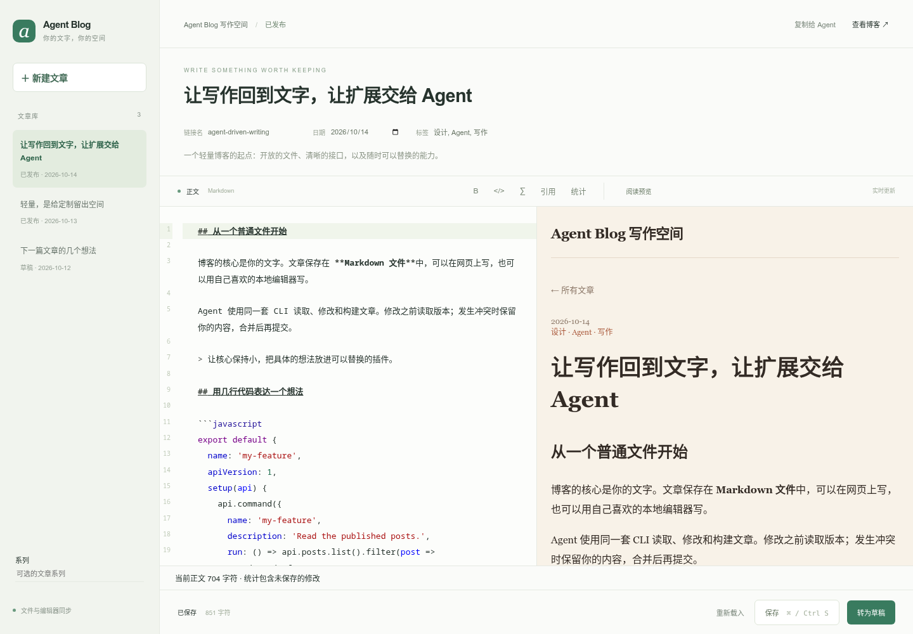
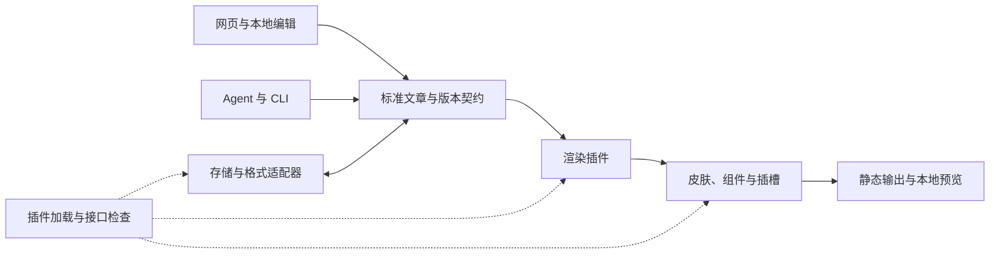

# Agent Blog

**让人自由写作，让 Agent 自由扩展。**

A small, pluggable blog framework for humans and coding agents.

[](LICENSE)
[](package.json)
[](docs/plugin-api.md)

[快速开始](#快速开始) · [Agent 工作流](#agent-工作流) · [插件广场](marketplace/README.md) · [插件开发](#插件开发) · [接口文档](docs/plugin-api.md) · [贡献指南](CONTRIBUTING.md) · [更新与升级](CHANGELOG.md)

Agent Blog 是一个以 Agent 为主要开发者和操作者的轻量博客框架。人可以在网页或本地文件里写作，Agent 可以通过 CLI 读取文章、提交修改、发现已有能力，并编写新的插件。

**功能必须以独立插件实现。** 新增功能分别拥有自己的配置、内容字段、CLI 与编辑入口；内核只承载通用协议，皮肤只负责展示。插件按声明的依赖协作，关闭插件保留内容。

核心没有运行时依赖。文章格式、存储、渲染、皮肤、页面组件、编辑器工具和构建流程都有公开扩展入口。默认内容保存在可读的 Markdown 文件里，最终博客输出为静态文件。

**项目状态：** 早期开发版本 `0.2.0`，插件协议 `apiVersion: 1`。目前从源码运行，尚未发布到 npm。现有能力与运行边界见下文。

## 为什么选择 Agent Blog

- **Agent 可以发现接口。** `schema --json` 描述核心命令、插件命令、参数、输入格式和扩展点。
- **人和 Agent 共用内容。** 网页编辑、CLI 和普通文本编辑器默认使用同一批文章文件。
- **按需组合功能。** Markdown、代码高亮、数学公式、网页编辑器和皮肤都是独立插件。
- **可以细到一个组件。** 能替换整页，也能只替换页头、文章卡片或页脚；编辑器支持按钮、面板、字段和语法扩展。
- **修改有版本保护。** 更新和删除要求最新 revision；发生冲突时保留编辑内容，交给人或 Agent 合并。
- **内容可以独立发布。** 默认构建排除草稿和编辑器资源，生成的静态博客无需运行框架服务。

## 界面预览

皮肤使用同一批示例文章。皮肤改变页面布局与样式，文章源文件保持不变。

| 纸张皮肤 | 暗色终端皮肤 |
| --- | --- |
|  |  |

[守望先锋 2 灵感皮肤](packages/theme-overwatch/README.md)采用橙白配色、深蓝灰 HUD、切角卡片与包内原创未来建筑场景。


<details>
<summary>查看网页编辑器</summary>



</details>

## 快速开始

需要 **Node.js 22 或更新版本**及 npm。克隆仓库后启动示例：

```sh
git clone https://github.com/Junming-Liang/agent-blog.git
cd agent-blog
npm ci --ignore-scripts
npm run build:editor
npm run dev
```

打开：

- 博客预览：<http://127.0.0.1:4173/>
- 网页编辑器：<http://127.0.0.1:4173/__editor/>

示例站点已启用 Markdown、代码高亮、数学公式、网页编辑器、纸张皮肤和写作工具。编辑器提供正文高亮、实时预览、保存快捷键、版本冲突提示及「复制给 Agent」。

生成静态博客：

```sh
npm run build
```

结果位于 `examples/demo/dist/`。`build` 生成本地文件，发布到静态托管服务由使用者自行完成。

### 创建自己的站点

以下命令同样在框架仓库根目录执行，使用已安装的 workspace CLI：

```sh
npm exec -- agent-blog init ./my-blog
npm exec -- agent-blog new hello --title "我的第一篇文章" --site ./my-blog --json
npm exec -- agent-blog serve --site ./my-blog --port 4174
```

不带 `--preset` 时创建默认最小系统，直接启用当前的 18 个插件：Markdown、高亮、公式、编辑器、编辑器语言、编辑器着色、Agent 上下文、纸张皮肤、说说、页面、导航、归档、友情链接、日期格式、页脚、保存后构建、WordPress 迁移及插件广场。源码安装同时附带终端皮肤与守望先锋 2 灵感皮肤，供替换默认皮肤。

这些功能都保留为独立插件，可以逐项停用、替换或扩展。新文章默认是草稿；保存或发布后会重新生成本地静态站点，部署到公网由使用者控制。

需要自行组合时，`--preset minimal` 显式创建纯核心站点；`--preset writer` 保留仅启用七个写作与编辑插件的旧预设。新建站点不会改变已有站点的配置。

## Agent 工作流

任何能调用 CLI 或操作本地文件的 coding agent 都可以使用 Agent Blog。框架通过公开命令和文件契约接入 Agent，模型账号与服务由使用者选择。

先发现能力，再读取当前文章：

```sh
npm exec -- agent-blog schema --site ./my-blog --json
npm exec -- agent-blog get hello --site ./my-blog --json
```

`get` 返回文章正文、完整元数据与 revision。Agent 修改时通过 `put` 的标准输入提交 `{metadata, body}`，并将刚读取的 revision 传给 `--if-revision`。保留自定义元数据；收到 `CONFLICT` 后重新读取并合并。

也可以直接使用公开内容 API。下面的示例保留元数据，用读取到的版本追加一段正文：

```js
import {loadSite} from '@agent-blog/core';

const blog = await loadSite('./my-blog');
const current = blog.posts.read('hello');
blog.posts.write('hello', {
  metadata: current.metadata,
  body: current.body + '\n\n由 Agent 追加的段落。\n'
}, current.revision);
const warnings = await blog.flushEvents();
if (warnings.length) console.error(warnings);
```

CLI 成功输出 `{ok:true,data}`，失败输出 `{ok:false,error:{code,message}}` 并返回非零退出码。插件通知失败会单独报告 warnings，已经提交的文章仍然保存成功。

从 WordPress 迁移时，可启用独立的 `@agent-blog/wordpress` 插件，将旧文章、页面和说说转换为 Markdown，并保留公开状态、来源 ID 与内容指纹。[迁移和服务器部署说明](deploy/README.md) 包含只读导出、媒体迁移、旧链接兼容、沿用原站登录及保存后构建的部署适配器。

| 操作 | 命令 |
| --- | --- |
| 发现全部能力 | `schema` |
| 列出文章与草稿 | `list` |
| 读取文章和版本 | `get` |
| 创建草稿 | `new` |
| 更新、发布、删除 | `put` / `publish` / `remove`，要求当前 revision |
| 构建与预览 | `build` / `serve` |
| 管理插件 | `plugins` / `plugin scaffold` / `plugin enable` / `plugin disable` |

网页的「复制给 Agent」会复制文章位置、当前 revision、未保存内容及相关 CLI 参数，便于 Agent 接着工作。

## 插件开发

每个插件是一个导出声明对象的 JavaScript 模块，可以是本地文件或已安装的 npm 包。一个插件可以同时增加 CLI 命令、页面组件和编辑器工具。

```js
/** @type {import('@agent-blog/core').Plugin} */
export default {
  name: 'my-notes',
  apiVersion: 1,
  description: 'Count published notes and add an article footer.',
  setup(api) {
    api.command({
      name: 'note-count',
      description: 'Count published articles.',
      run() {
        return {posts: api.posts.list().filter(post => !post.metadata.draft).length};
      }
    });
    api.slot('post:after', ({post}) =>
      `<aside>${api.escapeHTML(post.metadata.title)} · 感谢阅读</aside>`
    );
  }
};
```

把该文件保存为站点的 `plugins/my-notes.mjs`，然后启用：

```sh
npm exec -- agent-blog plugin enable ./plugins/my-notes.mjs --site ./my-blog
npm exec -- agent-blog note-count --site ./my-blog --json
```

也可以让框架生成一个能直接运行的文章统计插件，再让 Agent 修改它：

```sh
npm exec -- agent-blog plugin scaffold stats --site ./my-blog
npm exec -- agent-blog plugin enable ./plugins/stats.mjs --site ./my-blog
npm exec -- agent-blog stats --drafts --site ./my-blog --json
```

插件通过 `requires` 声明必需依赖，通过 `optionalRequires` 声明可选联动，通过 `extends` 声明继承的基础插件。核心检查接口版本、依赖顺序、服务访问和路由／输出冲突。新增命令自动进入 `schema`。修改插件源码或配置后重启预览进程。

### 扩展接口

| 功能层 | 公开接口 | 可以实现什么 |
| --- | --- | --- |
| 文章格式与存储 | `codec`、`storage`、`validator` | 新格式、同步存储适配器、自定义字段检查 |
| 正文渲染 | `renderer`、`transform` | Markdown、公式、高亮、正文处理 |
| 皮肤与组件 | `layout`、`component`（含 fallback）、`slot`、`indexFilter` | 整页主题、卡片、导航、页脚、相关文章 |
| 静态输出 | `output`、`asset`、`stylesheet` | 独立页面、RSS、搜索索引、样式和脚本 |
| URL 与构建 | `permalink`、`builder` | 自定义文章路径、构建包装或替换 |
| Agent 与本地工具 | `command`、`execute`、`commandMiddleware` | 导入、检查、模型调用及写作工作流 |
| HTTP 与通知 | `route`、`middleware`、`on` | 本地工具接口、请求处理和完成通知 |
| 插件协作 | `provide`、`require`、`optional` | 分享服务并组合功能 |
| 编辑器内部 | editor service + browser API | 按钮、面板、字段、事件和 CodeMirror 扩展 |

完整协议：[插件开发说明](docs/plugin-api.md)。类型定义：[核心 API](packages/core/api.d.ts)、[编辑器服务](packages/editor/api.d.ts)、[浏览器扩展](packages/editor/browser-api.d.ts)。

## 插件广场与社区投稿

[浏览 GitHub 插件广场](marketplace/README.md)。说说、页面、导航、归档、友情链接、日期格式、页脚、保存后构建及 Agent 编辑上下文均为独立插件；配置和操作见[独立功能插件](docs/bundled-plugins.md)。Markdown、高亮和公式插件分别提供自己的编辑按钮，禁用对应插件后按钮随之移除。

欢迎任何人通过 PR 分享插件。插件源码可保存在自己的公开仓库，广场收录元数据与固定 commit；也可贡献本仓库功能包。按照[投稿指南](docs/marketplace.md)新增 `marketplace/entries/<id>.json`，运行 `npm run marketplace:build` 和 `npm run marketplace:check`，使用[插件 PR 模板](.github/PULL_REQUEST_TEMPLATE/plugin.md)提交。

启用目录插件后，Agent 可离线发现插件及依赖：

```sh
npm exec -- agent-blog plugin enable @agent-blog/marketplace --site ./my-blog
npm exec -- agent-blog marketplace-list --query 说说 --site ./my-blog --json
npm exec -- agent-blog marketplace-get notes --site ./my-blog --json
```

目录查询只读取描述数据。安装、源码审阅及启用由站点维护者决定。插件在同一 Node.js 进程中运行，独立性通过注册、依赖、数据归属和启停契约保证；它不提供不可信代码的进程隔离。运行时报错会阻止失败构建替换已成功构建的页面，内容保存后的通知失败则独立返回警告。

## 皮肤与编辑器扩展

示例站点可以切换为暗色终端皮肤：

```sh
npm exec -- agent-blog plugin disable @agent-blog/theme-paper --site examples/demo
npm exec -- agent-blog plugin enable @agent-blog/theme-terminal --site examples/demo
npm run build
```

重启预览即可看到新皮肤。整体主题可以移除默认 CSS 并使用自己的布局和资源；组件插件可以只替换页头、文章卡片、元数据或页脚。

使用守望先锋 2 灵感皮肤时，同样先停用当前皮肤，再启用 `@agent-blog/theme-overwatch`。它没有其他插件依赖，也不更改内容或启用新的功能。完整切换、回退及验证说明见[主题文档](packages/theme-overwatch/README.md)。

[writing-tools 示例](examples/demo/plugins/writing-tools.mjs) 展示了更细的扩展：在现有编辑器中添加引用按钮、统计面板和文章系列字段，网页与 Agent CLI 共用 `writing-stats` 命令。

## 文章与配置

默认一篇文章对应一个 `content/slug.md`。文件开头是夹在 `---` 之间的 **JSON** 元数据，正文是 Markdown：

```markdown
---
{
  "title": "我的文章",
  "draft": true,
  "tags": ["研究"],
  "series": "我的笔记"
}
---
# 正文

行内公式：$E=mc^2$。
```

没有元数据头的文件按草稿读取。自定义字段在 CLI 和网页编辑时保留。其他 front matter 或文本格式可以通过 codec 插件实现；切换格式或存储时，内容迁移由相应插件负责。

站点的 `blog.json` 配置插件、启用状态和选项。完整配置见 [示例站点](examples/demo/blog.json)。

```json
{
  "version": 1,
  "title": "我的博客",
  "plugins": [
    "@agent-blog/markdown",
    "@agent-blog/editor",
    {"use": "@agent-blog/theme-paper", "options": {}},
    {"use": "./plugins/my-notes.mjs", "enabled": true}
  ]
}
```

## 架构与运行边界



核心保留插件加载、标准内容契约、接口检查、版本保护及本地预览边界；功能模块可以通过插件替换或组合。

- **本地编辑。** 预览固定监听 `127.0.0.1`。公网阅读可以部署 `dist`；公网编辑需要使用者另外提供身份验证和服务边界。
- **同步存储。** v1 的内容、codec、storage 和字段校验采用同步接口。直接访问异步远程存储需要同步缓存或导入层；命令、渲染、请求、构建及通知支持异步。
- **可信插件。** 插件具有运行用户的权限，当前没有插件隔离沙箱。
- **操作后的通知。** 生命周期通知是进程内队列，提供失败 warnings；持久化任务、定时调度和自动重试由使用者扩展。
- **版本与文件锁。** 框架写入串行化并比较版本。普通文件编辑器不参与该锁，因此不能保证与任意外部程序瞬间同时写入的事务隔离。
- **自定义构建。** 默认构建排除草稿；自定义构建适配器负责履行相同的内容公开约定。

格式、皮肤、编辑器和内容所有权的详细契约见 [接口文档](docs/plugin-api.md)。

## 仓库导航

| 路径 | 内容 |
| --- | --- |
| [packages/core](packages/core) | 零运行时依赖核心、CLI 和公开类型 |
| [packages/markdown](packages/markdown)、[highlight](packages/highlight)、[math](packages/math) | 可选内容渲染插件 |
| [packages/wordpress](packages/wordpress)、[deploy](deploy) | 可选迁移插件与服务器部署适配器 |
| [packages/editor](packages/editor) | 网页编辑器及其扩展协议 |
| [packages/theme-paper](packages/theme-paper)、[theme-terminal](packages/theme-terminal)、[theme-overwatch](packages/theme-overwatch) | 可替换皮肤 |
| [examples/demo](examples/demo) | 示例站点、文章和使用者插件 |
| [docs/plugin-api.md](docs/plugin-api.md) | 插件协议与开发说明 |
| [tests](tests) | 内容、插件、编辑器和类型契约测试 |

## 参与贡献

欢迎贡献插件、皮肤、文档和接口改进。请先阅读 [贡献指南](CONTRIBUTING.md) 和 [Agent 开发约定](AGENTS.md)。提交问题时附上复现步骤、Node.js 版本和最小插件配置；避免包含私人文章或凭据。

开发检查：

```sh
npm run build:editor
npm test
npm run test:types
npm run build
```

## 许可证与致谢

Agent Blog 使用 [MIT 许可证](LICENSE)。可选插件使用的第三方库遵循各自的许可证；名单见 [第三方依赖说明](THIRD_PARTY_NOTICES.md)。

README 的组织方式参考了 [Astro](https://github.com/withastro/astro)、[Hugo](https://github.com/gohugoio/hugo) 和 [Vite](https://github.com/vitejs/vite) 的公开项目文档。Agent Blog 是独立项目。
