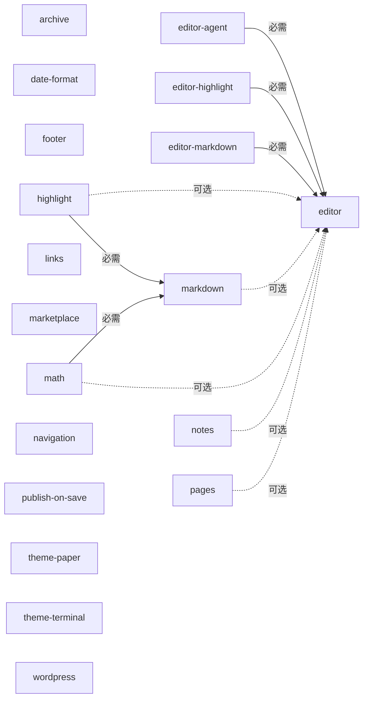

# Agent Blog 插件广场

每个功能独立安装、配置和禁用。欢迎通过 Pull Request 分享插件；提交方式、元数据约定及审核范围见[参与指南](../docs/marketplace.md)。

本目录由 `marketplace/entries/*.json` 与各包的 `plugin.json` 核对后生成。提交条目后运行 `node scripts/check-marketplace.mjs`；使用 `--check` 核对生成结果。条目是描述数据，收录不代表安全审计。插件启用后属于受信任的本地代码，拥有当前进程权限。

所有条目兼容插件 API v1。必需依赖和继承的基础插件必须启用；可选联动在对方缺席时仍可运行。继承通过基础插件的公开服务与组件回退组合实现。完整 npm 依赖和来源固定版本见[机器可读目录](../packages/marketplace/catalog.json)或每个[原始条目](entries/)。

| 插件 / 源码 | 名称与用途 | 分类 | 依赖与继承 | 直接影响范围 | 许可证 | 作者 |
| --- | --- | --- | --- | --- | --- | --- |
| [archive](../packages/archive) / [清单](../packages/archive/plugin.json) | 文章归档：生成文章归档页，支持配置兼容旧链接的页面。 | content | 无 | 无 | MIT | [Agent Blog contributors](https://github.com/Junming-Liang/agent-blog) |
| [date-format](../packages/date-format) / [清单](../packages/date-format/plugin.json) | 日期格式：通过独立的日期展示组件配置时区和显示格式。 | rendering | 无 | 无 | MIT | [Agent Blog contributors](https://github.com/Junming-Liang/agent-blog) |
| [editor-agent](../packages/editor-agent) / [清单](../packages/editor-agent/plugin.json) | Agent 交接：为编辑器添加复制给 Agent 的内容交接操作。 | editor | 必需：editor | 无 | MIT | [Agent Blog contributors](https://github.com/Junming-Liang/agent-blog) |
| [editor-highlight](../packages/editor-highlight) / [清单](../packages/editor-highlight/plugin.json) | 编辑器语法高亮：为网页编辑器添加语法着色，可独立启用或禁用。 | editor | 必需：editor | 无 | MIT | [Agent Blog contributors](https://github.com/Junming-Liang/agent-blog) |
| [editor-markdown](../packages/editor-markdown) / [清单](../packages/editor-markdown/plugin.json) | 编辑器 Markdown 语言：为网页编辑器添加 Markdown 语言支持及代码围栏语言识别。 | editor | 必需：editor | 无 | MIT | [Agent Blog contributors](https://github.com/Junming-Liang/agent-blog) |
| [editor](../packages/editor) / [清单](../packages/editor/plugin.json) | 网页编辑器：在浏览器中编辑与 CLI 共用的文章，提供编辑器扩展接口。 | editor | 无 | 必需依赖者：editor-agent, editor-highlight, editor-markdown 可选联动者：highlight, markdown, math, notes, pages | MIT | [Agent Blog contributors](https://github.com/Junming-Liang/agent-blog) |
| [footer](../packages/footer) / [清单](../packages/footer/plugin.json) | 页脚：通过插件选项配置页脚文字及链接。 | content | 无 | 无 | MIT | [Agent Blog contributors](https://github.com/Junming-Liang/agent-blog) |
| [highlight](../packages/highlight) / [清单](../packages/highlight/plugin.json) | 代码高亮：渲染代码围栏的语法高亮；可选提供编辑器代码块按钮。 | rendering | 必需：markdown 可选：editor | 无 | MIT | [Agent Blog contributors](https://github.com/Junming-Liang/agent-blog) |
| [links](../packages/links) / [清单](../packages/links/plugin.json) | 友情链接：生成友情链接页面，链接内容通过插件选项配置。 | content | 无 | 无 | MIT | [Agent Blog contributors](https://github.com/Junming-Liang/agent-blog) |
| [markdown](../packages/markdown) / [清单](../packages/markdown/plugin.json) | Markdown 渲染：通过 markdown-it 渲染 Markdown；可选提供编辑器加粗按钮。 | rendering | 可选：editor | 必需依赖者：highlight, math | MIT | [Agent Blog contributors](https://github.com/Junming-Liang/agent-blog) |
| [marketplace](../packages/marketplace) / [清单](../packages/marketplace/plugin.json) | 插件广场：离线搜索和查询目录元数据，供人和 Agent 审查选择插件。 | tools | 无 | 无 | MIT | [Agent Blog contributors](https://github.com/Junming-Liang/agent-blog) |
| [math](../packages/math) / [清单](../packages/math/plugin.json) | 数学公式：使用 KaTeX 渲染数学公式；可选提供编辑器公式按钮。 | rendering | 必需：markdown 可选：editor | 无 | MIT | [Agent Blog contributors](https://github.com/Junming-Liang/agent-blog) |
| [navigation](../packages/navigation) / [清单](../packages/navigation/plugin.json) | 导航：按配置提供站点导航和可扩展导航条目。 | content | 无 | 无 | MIT | [Agent Blog contributors](https://github.com/Junming-Liang/agent-blog) |
| [notes](../packages/notes) / [清单](../packages/notes/plugin.json) | 说说：独立的短内容类型、列表与 CLI，可选添加网页编辑入口。 | content | 可选：editor | 无 | MIT | [Agent Blog contributors](https://github.com/Junming-Liang/agent-blog) |
| [pages](../packages/pages) / [清单](../packages/pages/plugin.json) | 独立页面：管理关于页等独立内容，可选添加网页编辑入口。 | content | 可选：editor | 无 | MIT | [Agent Blog contributors](https://github.com/Junming-Liang/agent-blog) |
| [publish-on-save](../packages/publish) / [清单](../packages/publish/plugin.json) | 保存后发布：在内容保存或删除后重新生成公开静态页面。 | publishing | 无 | 无 | MIT | [Agent Blog contributors](https://github.com/Junming-Liang/agent-blog) |
| [theme-paper](../packages/theme-paper) / [清单](../packages/theme-paper/plugin.json) | 纸张主题：以纸张风格展示博客，可以独立替换或禁用。 | theme | 无 | 无 | MIT | [Agent Blog contributors](https://github.com/Junming-Liang/agent-blog) |
| [theme-terminal](../packages/theme-terminal) / [清单](../packages/theme-terminal/plugin.json) | 终端主题：以终端风格展示博客，可以独立替换或禁用。 | theme | 无 | 无 | MIT | [Agent Blog contributors](https://github.com/Junming-Liang/agent-blog) |
| [wordpress](../packages/wordpress) / [清单](../packages/wordpress/plugin.json) | WordPress 导入：从只读导出文件迁移内容，保留原始来源与发布状态。 | integration | 无 | 无 | MIT | [Agent Blog contributors](https://github.com/Junming-Liang/agent-blog) |

## 关系图

箭头从使用者指向其依赖或基础插件；虚线表示可选联动。更新插件时，从表中的直接影响范围继续检查下游；图和反向列表均自动生成。

离线查询：启用 `@agent-blog/marketplace` 后运行 `agent-blog marketplace-list --json` 或 `agent-blog marketplace-get notes --json`。目录插件不下载、不安装、不执行目录中的插件。
